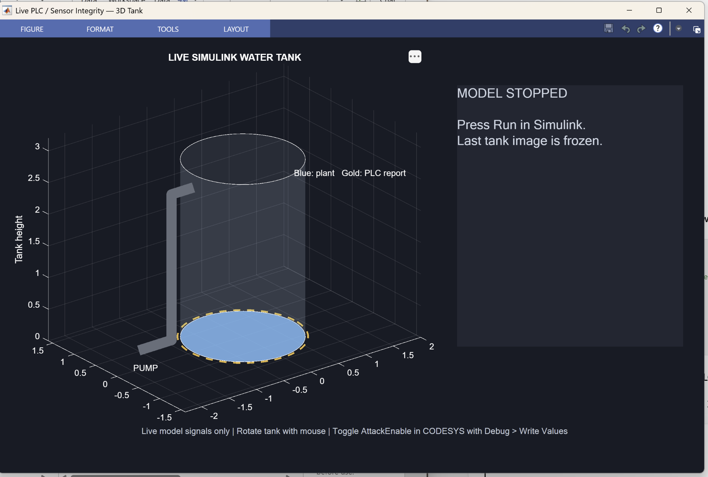
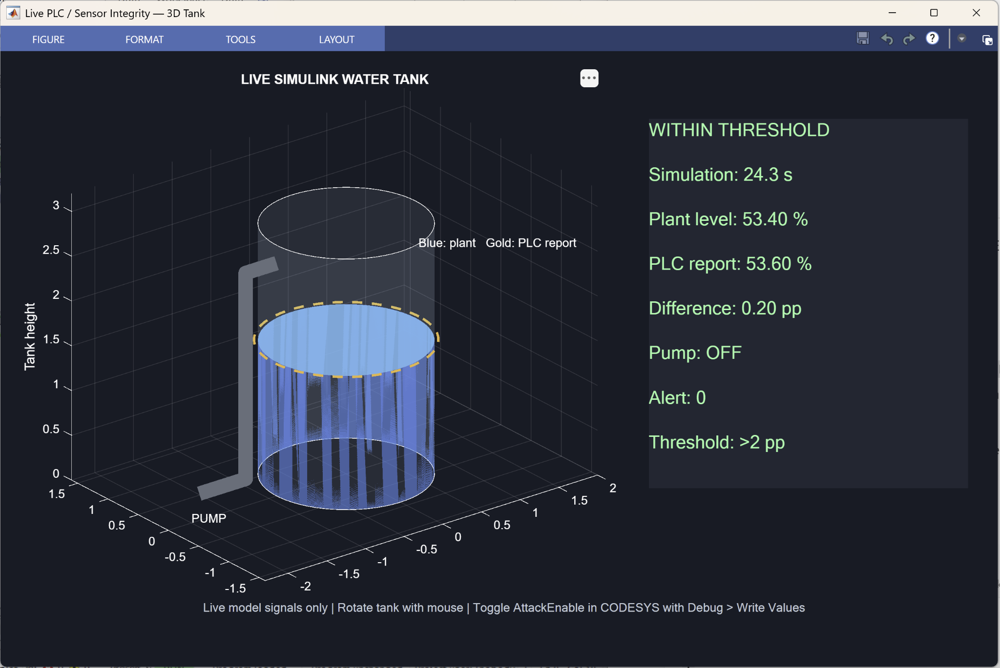
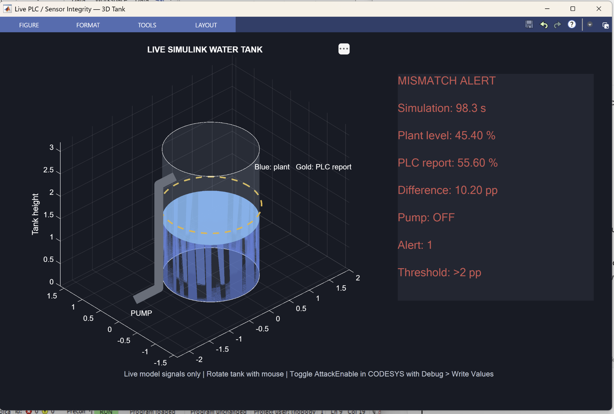

# Live 3D Simulation — Project 19

[← Project overview](README.md) · [MATLAB function](src/PLC_EDR_3D.m) · [Findings](reports/findings.md)

## What this view does

This is a live visualization of the existing Simulink/CODESYS closed-loop lab. The process dynamics, PLC control and mismatch detector remain in the existing model. The MATLAB figure reads those signals during simulation.

| Element | Meaning |
|---|---|
| Blue water | Direct Simulink plant level, used as the lab reference |
| Gold dashed ring | PLC-reported level |
| Green / grey pipe | Pump ON / OFF |
| Green status text | Alert 0, within the detector threshold |
| Red status text | Alert 1, mismatch above 2 percentage points |
| Amber status text | Runtime data could not be read |

A transparent cylinder is a visual representation, not a calibrated physical tank. No new 3D toolbox is required: this function uses MATLAB graphics and a timer alongside the already installed Simulink and Industrial Communication Toolbox.

## 1. Prepare the working model

First follow the [main guide](README.md) to build the tank and connect the CODESYS PLC. Stop Simulink before creating the 3D copy.

The native model and CODESYS project have not been uploaded. This function requires your locally built, working model.

Run in MATLAB from the folder containing the original model:

```matlab
load_system('PLC_EDR_WaterTank');
save_system('PLC_EDR_WaterTank','PLC_EDR_WaterTank_3D.slx');
open_system('PLC_EDR_WaterTank_3D');
```

If you already have the copy, just open it. Keep only one model actively writing the sensor register.

## 2. Add the MATLAB function

Download [src/PLC_EDR_3D.m](src/PLC_EDR_3D.m) into the model folder. Add that folder to the MATLAB path if necessary.

```matlab
which PLC_EDR_3D
PLC_EDR_3D('PLC_EDR_WaterTank_3D')
```

If MATLAB cannot find the function:

```matlab
[file, folder] = uigetfile('*.m', 'Select PLC_EDR_3D.m');
if ~isequal(file, 0)
    addpath(folder);
    which PLC_EDR_3D
    PLC_EDR_3D('PLC_EDR_WaterTank_3D');
end
```

Select the downloaded PLC_EDR_3D.m file. The model must be stopped when launching the function.

Expected command-window output:

```text
3D view ready for PLC_EDR_WaterTank_3D. Start CODESYS, then click Simulink Run.
```

The figure initially says WAITING FOR SIMULINK; its timer then shows MODEL STOPPED until the model runs.



The stopped figure contains a frozen or initial tank image. It is not evidence of a current process measurement.

## 3. Required model structure

The function expects these root-level blocks and numeric gain settings:

| Runtime signal | Block / port read |
|---|---|
| Plant level | Integrator output 1 |
| PLC report in percent | Output 1 of the unique Gain with value 0.01 |
| Absolute mismatch | Abs output 1 |
| Pump state | Input 1 of the unique Gain with value 5 |
| Alert | Display input 1 |
| Simulation time | Model SimulationTime |

Block names Integrator, Abs and Display must match. Gain expressions must be numeric values that str2double can resolve, and there must be exactly one matching gain of each value.

The function sets the copy to Normal mode, turns BlockReduction off and OptimizeBlockIOStorage off, and enables pacing at rate 1. These settings preserve runtime signal access. The invalid earlier parameter OptimizeBlockIO is not used.

The model should already have fixed-step ode4, a 0.1 s step, the documented Modbus sample interval of 0.1 s, and a 120 s demonstration stop time. Pacing is approximate and can lag behind wall time.

## 4. Run the baseline

1. Confirm the CODESYS application is running.
2. Set AttackEnable to FALSE; use Debug → Write Values and check the actual Value.
3. Release any manual MATLAB Modbus client with clear m.
4. Launch the 3D view while the model is stopped.
5. Click Run in Simulink.
6. After startup settles, check the live panel and rotate the tank with the mouse.



Observed baseline snapshot:

| Field | Captured value |
|---|---:|
| Simulation time | 24.3 s |
| Plant level | 53.40% |
| PLC report | 53.60% |
| Difference | 0.20 percentage points |
| Pump | OFF |
| Alert | 0 |

The gold ring is close to the water surface. The small difference is below the 2-point threshold. Timing is a plausible contributor to this difference, but its exact cause was not measured.

## 5. Enable the controlled false report

While Simulink remains running, prepare TRUE for AttackEnable in CODESYS and apply Debug → Write Values. Confirm the actual value changes.

The PLC program adds 10 percentage points to the report. Pump control still uses the original sensor input.



Observed alert snapshot:

| Field | Captured value |
|---|---:|
| Simulation time | 98.3 s |
| Plant level | 45.40% |
| PLC report | 55.60% |
| Difference | 10.20 percentage points |
| Pump | OFF |
| Alert | 1 |

The gold ring is visibly higher than the blue water. MISMATCH ALERT appears in red. The existing detector supplies Alert 1; the graphics function does not independently infer or change the alert.

## 6. Verify recovery and clean up

Prepare FALSE and apply Debug → Write Values while the model is still running. Confirm the actual PLC value is FALSE.

Expected recovery: the report approaches the plant level, the difference falls below the threshold, and the panel returns to WITHIN THRESHOLD with Alert 0. Capture this state before the simulation ends.

**Evidence status:** recovery was observed in the earlier 2D lab. A final recovery capture from the 3D view has not yet been provided. The two 3D snapshots and prior Scope trace do not establish one synchronized event timeline.

When finished, stop Simulink, verify AttackEnable FALSE, save the model and PLC project, and close the figure. Closing the figure stops/deletes its timer; it does not stop Simulink or the PLC application.

## How the code updates the view

A fixedSpacing MATLAB timer has a requested period of 0.15 s and BusyMode drop. Each refresh reads RuntimeObject port data sequentially, updates the tank height and report ring, then updates the panel and pump colour. This is an approximate display cadence, not a measured sampling or detection latency.

The tank geometry is clipped to 0–100% for drawing only. The numeric values and detector signal are not clipped by the graphics code. Transparent-surface stripes in the captures are rendering artifacts.

If the model is paused, the panel shows the current paused signals. If it is stopped, the last image freezes. A missing or invalid runtime signal produces LIVE DATA UNAVAILABLE rather than substitute values.

## Troubleshooting

| Symptom | Action |
|---|---|
| Unrecognized function PLC_EDR_3D | Put the file in the current folder or use addpath; check which PLC_EDR_3D |
| Model not loaded | Use load_system with the model file available in the current folder/path |
| Stop Simulink assertion | Stop the model before launching the view |
| Missing gain / block | Check the exact names and unique numeric Gain 0.01 and Gain 5 |
| Invalid OptimizeBlockIO parameter | Use the corrected file in this repository |
| LIVE DATA UNAVAILABLE | Read the warning; check Normal mode, block names and running/paused status; stop and relaunch the corrected function |
| Attack switch has no effect | Check actual AttackEnable, apply Write Values, and confirm both PLC and Simulink are running |
| Slow animation | Check simulation time; pacing and timer display updates are approximate |

## Scope

This extension visualizes an OT integrity-monitoring prototype. It is not a complete EDR system, PLC exploit, physical sensor validation, or automated response. A physical installation would need an independently trusted acquisition path and health checks.

References: [runtime block data](https://www.mathworks.com/help/simulink/ug/accessing-block-data-during-simulation.html), [signal storage reuse](https://www.mathworks.com/help/rtw/ref/signalstoragereuse.html), [MATLAB timer](https://www.mathworks.com/help/matlab/ref/timer.html), and [simulation pacing](https://www.mathworks.com/help/simulink/slref/simulationpacingoptions.html).
