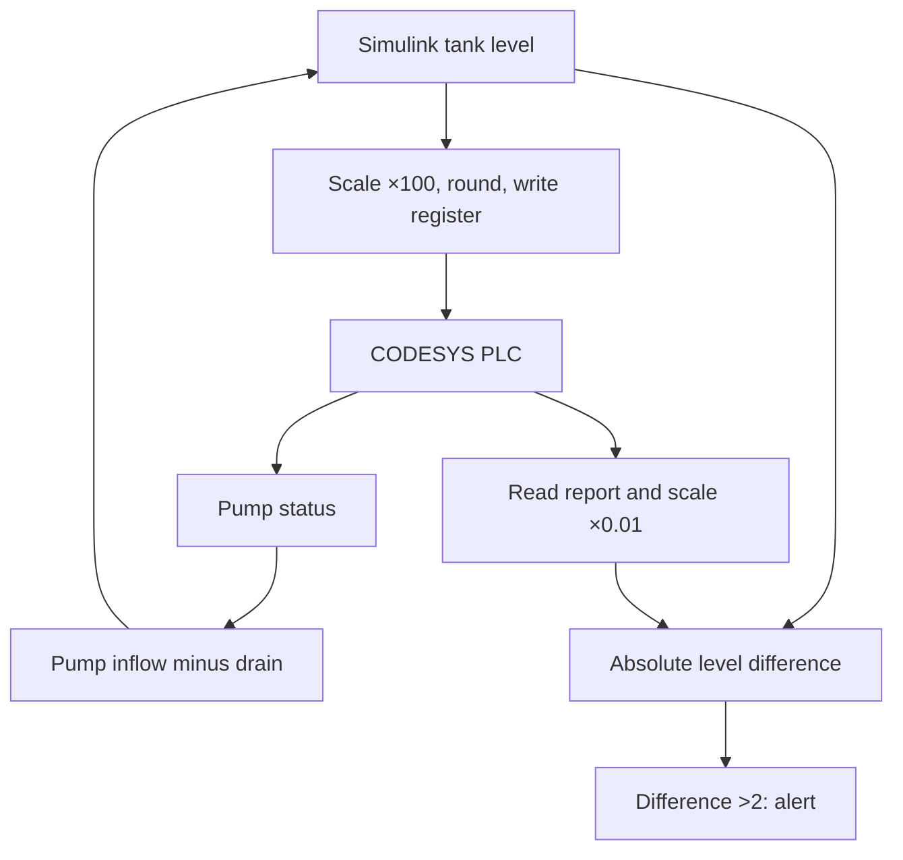
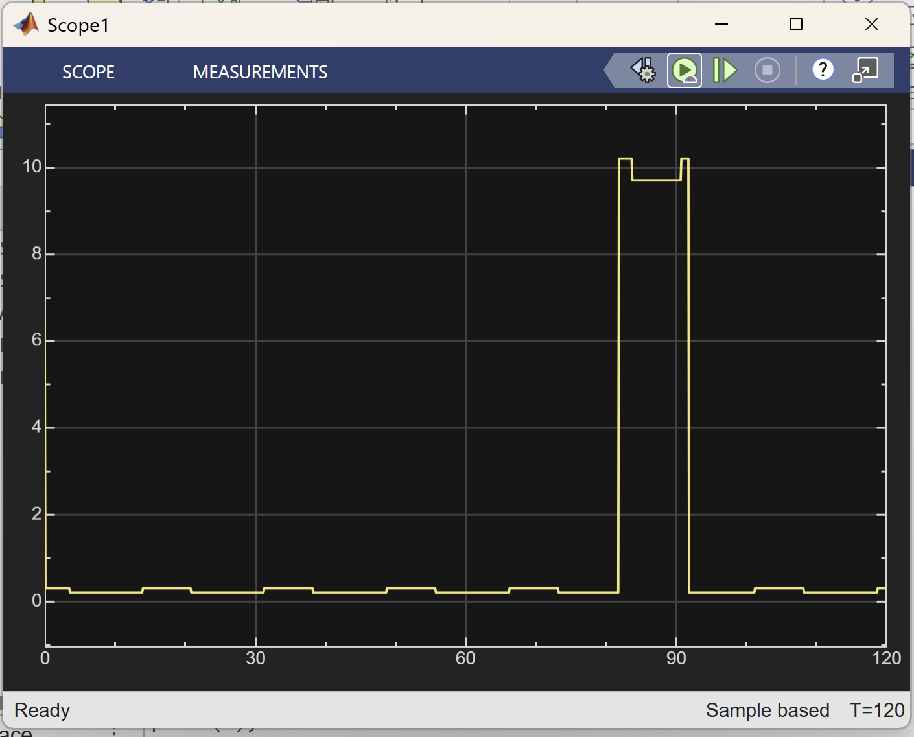

# Project 19 — PLC and Sensor Integrity Monitoring

[← Main project index](../../README.md) · [Findings](reports/findings.md) · [PLC source](src/PLC_PRG.st) · [Live 3D guide](3D-SIMULATION.md) · [MATLAB 3D code](src/PLC_EDR_3D.m)

**Author:** Tsedeneya Bayew  
**Status:** In progress — PLC false-report detection and recovery demonstrated; live 3D baseline and alert captured; broader EDR research continues.

## What I built

I connected a Simulink water-tank model to a CODESYS soft PLC through Modbus TCP. The PLC controls the simulated pump and reports the water level. A detector compares that report with the plant level obtained directly from Simulink, bypassing the PLC.

A controlled switch in the PLC adds 10 percentage points to the reported level. The detector raises an alert when the absolute difference exceeds 2 percentage points. The included mismatch graph shows the injected offset and recovery; alert activation and clearing were also observed during the lab.

This is an OT integrity-monitoring prototype toward an EDR research project. It does not demonstrate exploitation of a PLC, a complete EDR product, or automatic incident response.

## Live 3D visualization

The same tank model now drives a live MATLAB 3D view: blue water shows the direct Simulink plant level, a gold ring shows the PLC report, and a status panel displays pump state, mismatch and alert. The view reads runtime signals from the existing model; it does not generate substitute measurements.


**[Open the complete 3D setup and demonstration guide →](3D-SIMULATION.md)**

## Research question and trust boundary

Can an independent process measurement reveal a false PLC report even when communication still works?

In this lab, the Simulink plant output provides simulation ground truth. It is used both to feed the PLC and, through a separate branch, to feed the detector. In a physical installation, this reference would require separately trusted sensor acquisition. Reading two values from the same compromised PLC would not provide that independence.

A mismatch indicates inconsistent measurements. It does not, by itself, prove an attack or establish which measurement is trustworthy.

## Environment

| Component | Lab setup |
|---|---|
| Simulation | MATLAB and Simulink |
| Communication toolbox | Industrial Communication Toolbox |
| PLC IDE | CODESYS |
| PLC | Local CODESYS soft PLC |
| Transport | Modbus TCP in a local simulation lab |

OPC UA was attempted first but encountered certificate-usage errors. The demonstrated connection uses Modbus TCP. Credentials and certificates are excluded.

## Architecture



## 1. Map the Modbus registers

The CODESYS server was configured with 10 holding registers and 10 input registers, starting at offset 0, with register overlay disabled.

| Signal | CODESYS register offset | MATLAB / Simulink address | Direction |
|---|---:|---:|---|
| `SensorLevelRaw` | HoldingRegisters[0] | Holding register 1 | Simulink → PLC |
| `ReportedLevelRaw` | InputRegisters[0] | Input register 1 | PLC → Simulink |
| `PumpStatusRaw` | InputRegisters[1] | Input register 2 | PLC → Simulink |

Raw water-level values use hundredths of a percent: 5000 means 50.00%. Pump status is 1 for on and 0 for off. The server's holding-register write option was enabled and these registers were mapped to the corresponding `PLC_PRG` variables.

Initial command-window checks confirmed communication:

```matlab
% Configure plcHost and plcPort for your own local lab.
m = modbus("tcpip", plcHost, plcPort);

write(m, "holdingregs", 1, 7000);
pause(1);
read(m, "inputregs", 1, 2)
% Observed: [7000 0]

write(m, "holdingregs", 1, 3000);
pause(1);
read(m, "inputregs", 1, 2)
% Observed: [3000 1]

clear m
```

These checks were performed before the closed-loop run. Avoid concurrent manual writes to the tank's sensor register while Simulink is supplying it.

## 2. Implement PLC control and the simulation switch

Use [src/PLC_PRG.st](src/PLC_PRG.st). In the CODESYS editor, place the variable declarations in the upper pane and the executable statements in the lower pane.

- Convert the incoming WORD to a percentage by dividing by 100.
- Turn the pump on below 40%; turn it off above 60%.
- Between those limits, retain the previous pump state.
- Normally report the incoming sensor level.
- When `AttackEnable = TRUE`, report `SensorLevel + 10.0`.
- Export the report and pump status through the input registers.

The switch changes the report only. The pump continues using `SensorLevel`. The 10-point bias stays within 0–100% for the demonstrated tank cycle around 40–60%; the sample code does not clamp arbitrary injected values.

Build, log in, download/update the application, and start it. Leave `AttackEnable` FALSE for baseline operation.

## 3. Build the Simulink plant

| Path or block | Setting / connection |
|---|---|
| Modbus Client Read | Report address 1; pump address 2; input registers; uint16 precision |
| Pump path | Pump status → double → Gain 5 → positive input of plant Sum |
| Drain | Constant 2 → negative input of plant Sum |
| Tank | Plant Sum → Integrator, initial level 50, configured limits 0–100 |
| Sensor write path | Integrator → Gain 100 → round → double → Modbus Client Write |
| Modbus Client Write | Holding-register address 1; uint16 register precision |
| PLC-report conversion | ReportedLevelRaw → double → Gain 0.01 |
| Comparison | PLC report minus direct Integrator output → Abs |
| Alert | Abs → Compare to Constant, operator `>`, constant 2 → Display |
| Visualization | Integrator → tank Scope; Abs → mismatch Scope |

The configured communication sample interval is 0.1 s. The model was configured for fixed-step ode4 with a 0.1 s step. These settings are setup instructions, not an exported configuration audit.

The simplified tank equation is:

```text
rate of level change = 5 × PumpStatus − 2
```

This is an illustrative process model, not a calibrated physical tank.

**Important datatype detail:** uint16 is the Modbus register precision. The write block's input in this lab had to be an integer-valued **double**. A uint16 input produced a datatype error; an unrounded double produced a fractional-value error. Adding round before the double input resolved the issue.


## 4. Run a baseline

Enable simulation pacing and use a 120 s stop time for the demonstration:

```matlab
set_param("YOUR_MODEL_NAME", ...
    "EnablePacing", "on", "PacingRate", "1", "StopTime", "120");
save_system("YOUR_MODEL_NAME");
```

With the PLC application running and `AttackEnable = FALSE`, start Simulink. Confirm the tank cycles near the control limits and the Display reads 0 after startup settles.

Pacing is approximate. The captured run showed “Unable to pace at specified rate”; simulation time must not be treated as measured wall-clock detection latency.

## 5. Inject a false PLC report while Simulink runs

1. In CODESYS, prepare TRUE for `AttackEnable`.
2. Start the Simulink run and allow normal operation.
3. While the run is active, use **Debug → Write Values**.
4. Confirm the actual Value becomes TRUE; preparing TRUE alone does not apply it.
5. Return to Simulink and observe the alert Display.


Display 1 was observed during the active simulation. The corresponding screenshot is omitted because it includes private lab network information.

## 6. Remove the false report and inspect recovery

Prepare FALSE in CODESYS and apply it with **Debug → Write Values**. Check the actual value is FALSE. During an active Simulink run, the Display should return to 0.


Display 0 was observed during recovery; its screenshot is omitted because it includes private lab network information.

In the mismatch Scope, change **Settings → Axes Scaling → Scale Y-axis limits** from Manual to Auto, and enable scaling at stop. A stale manual scale initially made the graph appear blank.



The final captured trace spans 120 s and shows a roughly 10-point mismatch around 82–92 s. The earlier Display observations are not synchronized with this trace. Without exported samples and switch timestamps, they do not establish a synchronized event timeline.

## Results and limits

- Communication and pump-control checks succeeded.
- Normal operation had a small mismatch, visually about 0.2–0.3 percentage points in the final trace.
- The controlled report offset exceeded the 2-point threshold and activated the alert.
- Removing the offset cleared the alert.
- A startup spike is visible and can cause a nuisance alert; startup gating is not implemented.
- The small normal mismatch is consistent with sampling/update timing, but its cause has not been measured.
- The detector has no persistence filter, communication-health check, or independent reference-health check.
- Modbus TCP is used for this local demonstration; the application has no added authentication or message-integrity mechanism.
- PLC exploitation, physical sensor compromise, deployment to industrial equipment, and automated mitigation were not tested.

## Repository contents and next work

This folder includes documentation, the demonstrated PLC logic, the corrected MATLAB 3D function, the original Scope capture and two original 3D screenshots. The native `.slx` and `.project` files and exported time-series data have **not** been uploaded; the repository is not yet a turnkey executable lab.

Next milestones: timestamped signal logging, startup handling, persistent mismatch detection, sensor-path tampering with a trusted reference, communication-failure testing, and capture of final recovery in the 3D view.

## References

- [MathWorks: Modbus Client Read](https://www.mathworks.com/help/icomm/ug/modbusclientread.html)
- [MathWorks: Modbus Client Write](https://www.mathworks.com/help/icomm/ug/modbusclientwrite.html)
- [MathWorks: Simulation pacing](https://www.mathworks.com/help/simulink/slref/simulationpacingoptions.html)
- [CODESYS documentation](https://content.helpme-codesys.com/)

[Read the findings report →](reports/findings.md)
