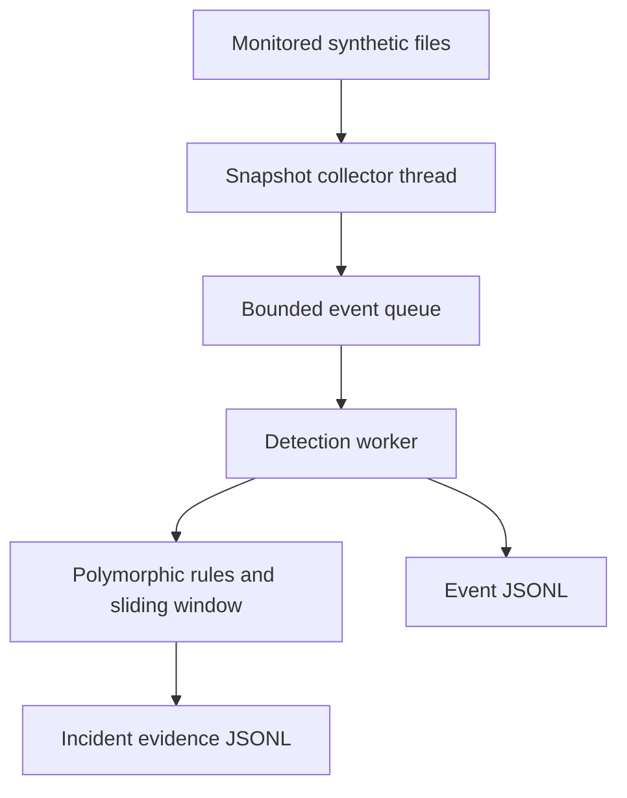

# Project 20 — C++ Behavioral Ransomware Detection Lab

[Advanced projects](../README.md) · [Main portfolio](../../README.md)

**Status: implementation and Linux automated validation complete; Windows toolchain and x64 CMake configuration verified; compilation, Windows tests, runtime validation, and screenshots pending.**

A C++17 defensive monitoring prototype that identifies suspicious combinations of file activity in a disposable test folder. It records events and explainable incident evidence without encrypting files, blocking applications, or changing the monitored data. The separate simulator only edits synthetic files it created in a dedicated sandbox.

This is a learning project, not an antivirus product or proof that ransomware is present. Ordinary bulk operations can trigger its heuristics.

## What is implemented

- Recursive, portable polling collector with a baseline and content sampling.
- Producer/consumer design using a mutex, condition variable, bounded queue, and a worker thread.
- Polymorphic detection rules managed with `std::unique_ptr`.
- Sliding-window correlation, distinct-file counting, alert cooldown, and severity escalation.
- Entropy sampling, a root-level canary, bulk changes, and a lab-specific extension pattern.
- JSON Lines event and incident logs, plus a JSON run summary.
- Explicit errors for unreadable files, queue/window overflow, and evidence-write failures.
- A harmless C++ simulator, unit tests, and subprocess integration tests.

**Backend: polling on all platforms.** Native Windows `ReadDirectoryChangesW`, process attribution, a GUI, and automatic containment are future extensions, not implemented features.

## Architecture



The initial snapshot establishes a baseline. Later snapshots produce `created`, `modified`, and `deleted` observations. A rename is represented as deletion plus creation; it is not a verified OS rename event. A fingerprint, file size, and modification time identify changes. Only a 64 KiB prefix is sampled for entropy and the noncryptographic FNV-1a fingerprint.

## Detection policy

Defaults are defined in `src/detector.hpp`.

| Rule | Condition within a 10-second window | Weight |
|---|---|---:|
| Distinct-file burst | At least 20 distinct modified or deleted paths | 2 |
| Canary change | Modification or deletion of root-level `CANARY_DO_NOT_EDIT.txt` | 4 |
| Entropy rise | At least 3 modified paths with sampled entropy ≥7.5 and increase ≥1.5 bits/byte | 1 |
| Lab extension correlation | At least 20 deleted paths paired with creation of the same name plus `.demo` | 2 |

A score of 2–3 produces a medium alert; 4 or above produces a high alert. Entropy alone does not alert. Cooldown is 10 seconds; a higher score can bypass cooldown. These weights are experimental teaching choices, not calibrated probabilities. The `.demo` rule tests correlation in this lab and is not a catalog of ransomware extensions. Counts apply to paths, not unique physical files or responsible processes.

## Files

| File | Purpose |
|---|---|
| `src/monitor.cpp` | Filesystem sampling, collection thread, worker lifecycle, evidence output |
| `src/detector.hpp` | Event model, rule interfaces, detector, entropy, queue, JSON serialization |
| `src/simulator.cpp` | Creates a dedicated sandbox and generates safe file activity |
| `tests/test_detector.cpp` | Deterministic rule, window, queue, and serialization tests |
| `tests/integration.py` | Real subprocess tests using temporary folders |
| `reports/validation.md` | Actual validation and known gaps |
| `reports/test-output.txt` | Captured automated test output |
| `reports/example-incident.json` | Incident recorded in a synthetic execution |
| `screenshots/README.md` | Checkpoints for your own Windows evidence |

## Prerequisites

- A local C++17 compiler and CMake 3.16 or newer.
- On Windows, Visual Studio or Build Tools with **Desktop development with C++** and the CMake tools installed.
- Python 3 is optional for end-to-end integration tests. Both applications and core tests are C++.
- Git to clone the portfolio, or download its ZIP from GitHub.

This project contains several source files, uses filesystem access and threads, and should be run locally rather than in a browser's single-file compiler.

## Windows setup evidence

The user verified MSVC 19.51.36260 and CMake 4.3.1-msvc1, cloned the repository, and successfully configured an x64 build with Visual Studio 18 2026. See [Windows setup observations](reports/windows-setup.md). Compilation and tests have not yet been demonstrated.

## Windows walkthrough

### 1. Open the project

Open **Developer PowerShell for Visual Studio**. Clone the repository into a location where you keep projects:

```powershell
git clone https://github.com/tsedeneya-bayew/cybersecurity-projects.git
cd cybersecurity-projects\advanced\20-cpp-ransomware-detection
```

If you already have a clone, use `git pull` inside it and navigate to this project instead.

### 2. Build and test

```powershell
cmake -S . -B build
cmake --build build --config Release
ctest --test-dir build -C Release --output-on-failure
```

The commands below assume a Visual Studio multi-configuration generator, which places binaries in `build\Release`. For a single-configuration generator such as Ninja, use `build\monitor.exe` and `build\simulator.exe` instead.

### 3. Create disposable test data

```powershell
.\build\Release\simulator.exe init .\ransomware-lab-sandbox
```

This creates 40 synthetic text documents, a canary, and a marker. Initialization refuses an existing sandbox. Keep the sandbox out of cloud-sync folders. All simulator activity is confined by its directory-name, marker, file-inventory, and link checks; it is not hardened against a hostile process racing those checks.

### 4. Start monitoring in the first terminal

```powershell
.\build\Release\monitor.exe .\ransomware-lab-sandbox .\reports-live-01 120 250
```

Arguments are watch folder, **new** report folder, duration in seconds, and polling interval in milliseconds. Watch and report folders must be separate and nonnested. Their parent directories must already exist. Wait for `BASELINE READY` before running the simulator.

### 5. Make one ordinary edit in a second terminal

Open a second Developer PowerShell in the same project directory:

```powershell
.\build\Release\simulator.exe normal .\ransomware-lab-sandbox
```

Expected: a modification event without an incident. This establishes one negative control; it does not establish a general false-positive rate.

### 6. Generate a safe burst

```powershell
.\build\Release\simulator.exe burst .\ransomware-lab-sandbox
```

This writes plain demonstration text to 30 synthetic files, renames them with `.demo`, and changes the canary. It performs no encryption and deletes no file contents outside the synthetic set. Watch for `ALERT` messages. Depending on scan timing, intermediate modifications may or may not be visible.

### 7. Inspect and explain the evidence

After the monitor exits, or after pressing Ctrl+C:

```powershell
Get-Content .\reports-live-01\summary.json
Get-Content .\reports-live-01\incidents.jsonl | ForEach-Object {
    $_ | ConvertFrom-Json | Format-List id, recorded_unix_ms, elapsed_seconds, severity, score, signals
}
```

Each incident includes triggering signals and the retained window of event evidence. `recorded_unix_ms` is the wall-clock recording time; event `elapsed_seconds` uses a monotonic clock from monitor start. Filename bytes above ASCII are escaped byte by byte in JSON; this is reversible byte evidence, not a Unicode display conversion.

Expected console shape (illustrative, not a promised count):

```text
BASELINE READY files=42 backend=polling
ALERT id=1 score=4 latest="CANARY_DO_NOT_EDIT.txt"
...
STOPPED events=62 incidents=3
```

Actual automated Linux evidence is in `reports/`; do not present it as your Windows execution.

### 8. Capture your own screenshots

Follow `screenshots/README.md`. Add real observations to `reports/my-lab-findings.md` if desired. Record the OS, compiler, scan interval, scenarios, observed alerts, and limitations. Do not mark Windows validation complete until you have run it.

### 9. Repeat or clean up

The burst mode changes the sandbox inventory, so repeating it is intentionally refused. Stop monitoring first, inspect that the sandbox contains only generated files, then manually delete **only** `ransomware-lab-sandbox` using File Explorer. Retain or remove generated report folders according to your evidence needs. Reinitialize and use a new report-folder name for another run.

## Linux build and test without CMake

From the project directory:

```bash
mkdir -p build
g++ -std=c++17 -Wall -Wextra -Wpedantic -pthread src/monitor.cpp -o build/monitor
g++ -std=c++17 -Wall -Wextra -Wpedantic src/simulator.cpp -o build/simulator
g++ -std=c++17 -Wall -Wextra -Wpedantic -pthread -Isrc tests/test_detector.cpp -o build/test_detector
./build/test_detector
python3 tests/integration.py ./build/monitor ./build/simulator
```

Interactive demo, using two terminals:

```bash
./build/simulator init ./ransomware-lab-sandbox
./build/monitor ./ransomware-lab-sandbox ./reports-live-01 120 250
# In the second terminal, from the same project directory:
./build/simulator normal ./ransomware-lab-sandbox
./build/simulator burst ./ransomware-lab-sandbox
```

## Engineering limits and threat model

- Intended for small, local, disposable lab folders with a trusted operator. The simulator checks are guardrails, not an adversarial sandbox boundary.
- Polling misses short-lived operations between snapshots; a file created and removed entirely between scans may never appear. Modification events can be coalesced.
- Scans are not atomic. Concurrent deletion or permission changes can cause an explicit incomplete-run error. Earlier logs remain partial evidence; only a successful run writes `summary.json` with `status=complete`.
- Samples cover at most 64 KiB per file. Tail-only changes that preserve size and timestamp can be missed. Entropy is sampled and does not establish encryption.
- FNV-1a is not collision resistant and is not SHA-256. No forensic integrity or tamper-proof logging claim is made.
- Symlinks are skipped by the collector. Junctions/reparse points on Windows need further hardening and testing. Do not monitor trees containing these links or files being changed by a hostile process.
- Hard links can produce multiple path observations for the same file. The simulator refuses hard-linked files before writing.
- Limits: 10,000 scanned files, 8,192 queued events, 100,000 retained window events. Overflow stops the run visibly. Rule evaluation rescans retained evidence and is unsuitable for high-volume production workloads.
- There is no process attribution, persistence/service installation, prevention, recovery, GUI, kernel telemetry, or automatic response.
- Bulk legitimate changes and canary edits can alert; slow activity below thresholds can evade the rules. No ransomware-family detection rate or performance benchmark has been measured.

## Next research extensions

1. Implement and test a Windows `ReadDirectoryChangesW` backend with cancellation and overflow recovery.
2. Add process attribution through an appropriate ETW event source and document event loss.
3. Measure false alerts and detection delay across editing, bulk copying, archive extraction, and multiple activity rates.
4. Add a read-only dashboard after validating evidence handling.

## References

- [Microsoft: CMake projects in Visual Studio](https://learn.microsoft.com/en-us/cpp/build/cmake-projects-in-visual-studio)
- [CMake command-line manual](https://cmake.org/cmake/help/latest/manual/cmake.1.html)
- [Microsoft: ReadDirectoryChangesW](https://learn.microsoft.com/en-us/windows/win32/api/winbase/nf-winbase-readdirectorychangesw) — reference for a future native backend, not used by this version.
