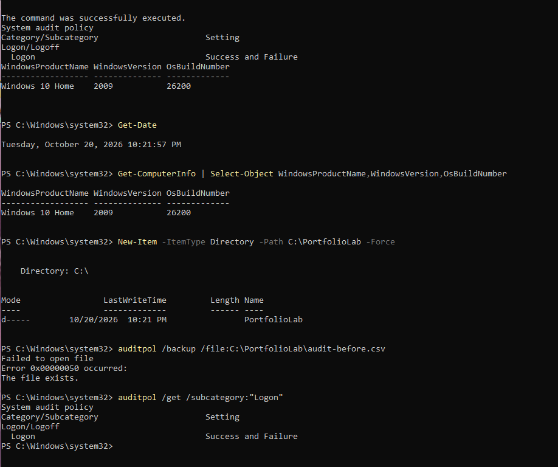
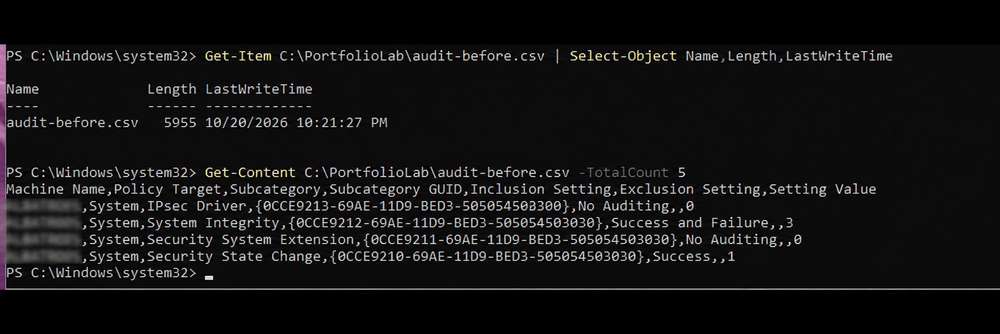
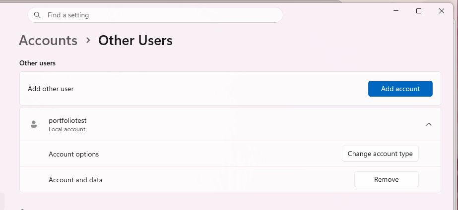

# Windows Security Event Logs

**Level:** Beginner · **Suggested time:** 1–2 hours · **Status:** In progress

> Started October 20, 2026 on the owner's Windows host. Step 1 baseline evidence is documented; the existing audit backup must be inspected before policy changes.

[← Project index](../../README.md)

## Objective

Complete a reproducible windows security event logs exercise, validate the behavior, and explain the evidence and limitations in a professional report.

## Environment and prerequisites

Windows with local administrator access, Event Viewer and PowerShell. A disposable Windows VM with a snapshot is preferred. This execution uses the owner's Windows host; preserve Security logs, record the existing policy, restore only lab changes, and remove the temporary lab account after testing. Commands assume English-language Windows; localized audit category names may differ.

## How to use this repository

1. Read the environment and scope before starting. Use a disposable VM for administrative changes.
2. Follow steps in order. Record actual output; expected results are predictions, not completed evidence.
3. Save screenshots using the exact filenames shown below in `screenshots/`.
4. Add each image under its step using ``. Step 1 evidence is included below.
5. Complete [your findings report](reports/findings.md). Record deviations and failed checks honestly.
6. Change **Not started** to **In progress** when you begin. Mark **Completed** only after your evidence and report are committed.

For browser uploads: open the destination folder → Add file → Upload files → select your sanitized files → Commit changes. To edit Markdown: open the file → pencil icon → edit → preview → commit with a descriptive message. Do not upload passwords, tokens, personal identifiers, or unrelated logs.

## Step-by-step lab

### 1. Record the baseline

Open PowerShell as Administrator:
```powershell
Get-Date
Get-ComputerInfo | Select-Object WindowsProductName,WindowsVersion,OsBuildNumber
New-Item -ItemType Directory -Path C:\PortfolioLab -Force
auditpol /backup /file:C:\PortfolioLab\audit-before.csv
auditpol /get /subcategory:"Logon"
```
Save the audit baseline locally. It is used to restore the previous policy.

**Screenshot checkpoint:** 01-baseline.png: OS version and logon auditing state.



**Observed result:** PowerShell records October 20, 2026, 10:21:57 PM. Get-ComputerInfo reports WindowsProductName `Windows 10 Home`, WindowsVersion `2009`, and OsBuildNumber `26200`; these are the reported fields, not independent verification of the marketed OS release. `C:\PortfolioLab` exists. Logon auditing is already `Success and Failure`, so Step 2 need not enable it again. The repeated backup command fails with `0x00000050` / `The file exists.` An earlier success message is visible without its command; it does not independently validate the existing backup. Preserve that file and inspect it before making changes:

```powershell
Get-Item C:\PortfolioLab\audit-before.csv | Select-Object Name,Length,LastWriteTime
Get-Content C:\PortfolioLab\audit-before.csv -TotalCount 5
```

Do not delete or overwrite the existing baseline. Step 1 backup validation remains pending.



**Backup inspection:** The backup check shows `audit-before.csv` exists, has length `5955` bytes, and was last written October 20, 2026 at 10:21:27 PM. Reading its first five lines shows a CSV header and four audit-policy records. The computer name is blurred in the published privacy-edited copy. This verifies a nonempty, readable CSV excerpt, not full backup validity or successful restoration. The saved Logon row is not visible. Current Logon auditing was already Success and Failure; no additional change is required for that setting.

### 2. Enable relevant auditing

```powershell
auditpol /set /subcategory:"Logon" /success:enable /failure:enable
```
This enables success and failure logon auditing in the VM. Create a standard local lab user in Settings → Accounts → Other users → Add account → Add a user without a Microsoft account. Use username `portfolio_test` and a unique lab-only password. Do not display or publish the password.

**Screenshot checkpoint:** 02-auditing.png: enabled logon auditing; no password visible.



**Observed account:** Settings → Accounts → Other Users shows `portfoliotest` as a Local account, with its password form closed. This differs from the guide's example name `portfolio_test`; use the actual name `portfoliotest` for subsequent commands and event filtering. The screenshot does not display the account type, so Standard User membership still needs verification. No password or unrelated personal information is visible. The Step 1 screenshot already records Success and Failure auditing; no additional policy change is claimed.

### 3. Generate controlled failures

In a normal terminal run `runas /user:.\portfoliotest cmd`. Enter a wrong lab password once. Repeat once if necessary; then run it again with the correct password and close the opened shell. Use only this lab account and stop after two failures. Record the time before and after the test.

**Screenshot checkpoint:** 03-test-window.png: timestamps and runas outcome without credentials.

### 4. Inspect Event Viewer

Open Event Viewer → Windows Logs → Security → Filter Current Log. Enter `4624,4625`. Look in your recorded time window for the lab username. Event 4624 indicates successful logon; 4625 indicates failed logon. Distinguish unrelated background events. Open Details → XML to inspect field names.

**Screenshot checkpoint:** 04-event-viewer.png: relevant event with lab username and event ID.

### 5. Query with PowerShell

```powershell
Get-WinEvent -FilterHashtable @{LogName='Security'; Id=4624,4625; StartTime=(Get-Date).AddMinutes(-30)} |
 Select-Object TimeCreated,Id,Message |
 Format-List
```
Identify your lab account in the messages. Record logon type, status/substatus where present, and origin information. Do not assume every event has a remote IP; local logons often do not.

**Screenshot checkpoint:** 05-query.png: relevant filtered event.

### 6. Report and restore

Write a timeline separating successful and failed events. Explain why two failures alone do not prove an attack. Restore policy in elevated PowerShell:
```powershell
auditpol /restore /file:C:\PortfolioLab\audit-before.csv
```
Retain the test VM snapshot or revert it. Avoid uploading raw Security log exports containing real identities.

**Screenshot checkpoint:** 06-timeline.png: sanitized event timeline.

## Troubleshooting

Access denied requires an elevated shell. If no lab events appear, verify audit policy and widen the time window. On non-English Windows, enumerate names with `auditpol /list /subcategory:*`.

## Questions to answer in your report

- What distinguishes 4624 and 4625?
- How does logon type influence interpretation?
- What additional evidence would support a brute-force hypothesis?

## Completion checklist

- [ ] Environment and exact scope recorded
- [ ] All lab steps attempted and actual outcomes documented
- [ ] Screenshots uploaded and linked under their steps
- [ ] Findings distinguish observation from interpretation
- [ ] Limitations and remediation explained
- [ ] Cleanup or restoration completed
- [ ] Findings report completed; status updated in this repository and portfolio index

## Official references

- https://learn.microsoft.com/en-us/previous-versions/windows/it-pro/windows-10/security/threat-protection/auditing/event-4625
- https://learn.microsoft.com/en-us/windows/security/threat-protection/auditing/basic-security-audit-policy-settings
